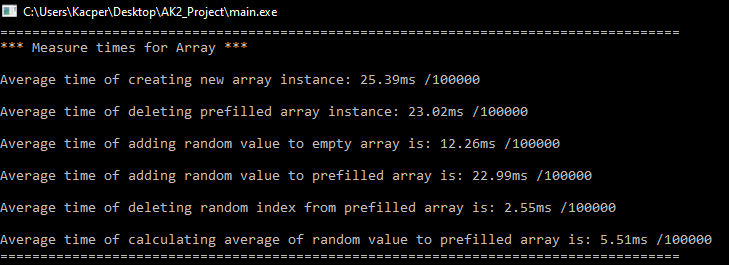

# DataStructures Performance Benchmark

A comprehensive benchmarking suite for comparing the performance of common data structures in C++.

## Overview

This project provides an empirical analysis of time complexity for common operations across six fundamental data structures:

- Array
- Stack
- Queue
- Binary Search Tree (BST)
- Linked List
- Max Heap

Each data structure is tested for various operations to help developers understand real-world performance implications beyond theoretical time complexity.

## Features

- **Standardized Testing Framework**: All data structures are tested under identical conditions
- **Comprehensive Operation Testing**:
  - Creation of new instances
  - Deletion of prefilled instances
  - Adding elements to empty structures
  - Adding elements to prefilled structures
  - Removing elements from structures
  - Calculating averages of elements
- **Statistical Validity**: Each operation is tested multiple times (default: 1000) to ensure reliable results
- **Easy Comparison**: Results are displayed in a consistent format for simple comparison

## Build Instructions

Compile the project using g++:

```bash
g++ -o benchmark main.cpp structures/array.cpp structures/linkedlist.cpp structures/queue.cpp structures/timer.cpp structures/bintree.cpp structures/maxheap.cpp structures/stack.cpp
```

## Usage

Simply run the compiled executable:

```bash
./benchmark
```

The program will run all tests and display performance metrics for each operation on each data structure.

## Test Parameters

- **Test Units**: 1000 iterations per operation (configurable)
- **Prefill Size**: 12 elements (configurable)
- **Random Values**: Float values between 0 and 100

## Interpreting Results

Results are reported as average execution times in milliseconds (scaled by 100000 for precision). Lower values indicate better performance.

## Project Structure

```
├── main.cpp                 # Main testing framework
├── structures/
│   ├── array.h/cpp          # Dynamic array implementation
│   ├── bintree.h/cpp        # Binary search tree implementation
│   ├── linkedlist.h/cpp     # Linked list implementation
│   ├── maxheap.h/cpp        # Max heap implementation
│   ├── queue.h/cpp          # Queue implementation
│   ├── stack.h/cpp          # Stack implementation
│   └── timer.h/cpp          # Timer utility for benchmarking
```

## Contributing

Contributions are welcome! Consider adding:
- Additional data structures
- More test cases
- Visualization of results
- Performance optimization tips based on results

## Images

